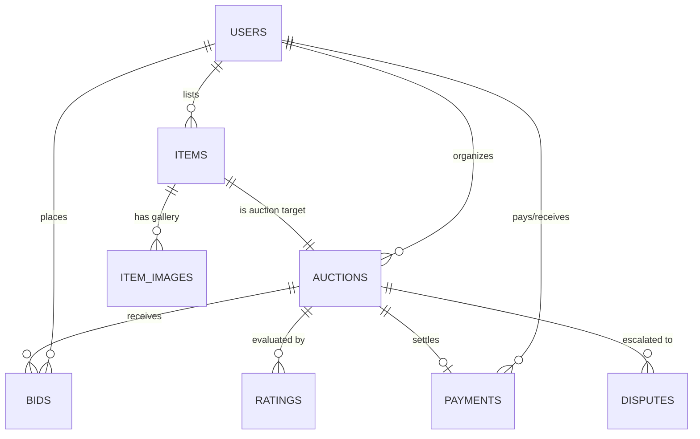

# Database Schema & Entity Relationship Model

The database runs on **MySQL 8.0** with strict UTF8MB4 collation and relational integrity foreign keys.

## 1. Relational Entity Overview

## 2. Table Catalog

| Table Name | Primary Purpose | Key Fields |
| :--- | :--- | :--- |
| `users` | User credentials & roles | `id`, `username`, `email`, `role`, `is_verified` |
| `items` | Physical / digital asset specs | `id`, `seller_id`, `title`, `starting_price`, `reserve_price` |
| `auctions` | Live auction lifecycle state | `id`, `item_id`, `current_highest_bid`, `status`, `end_time` |
| `bids` | Immutable bid ledger | `id`, `auction_id`, `bidder_id`, `amount`, `created_at` |
| `payments` | Stripe escrow transaction records | `id`, `auction_id`, `payer_id`, `amount`, `status` |
| `ratings` | Buyer & seller reputational feedback | `id`, `auction_id`, `score`, `comment` |
| `disputes` | Resolution & mediation tickets | `id`, `auction_id`, `complainant_id`, `status` |
| `auction_history` | Audit trail & forensic log | `id`, `auction_id`, `action_type`, `old_state`, `new_state` |
